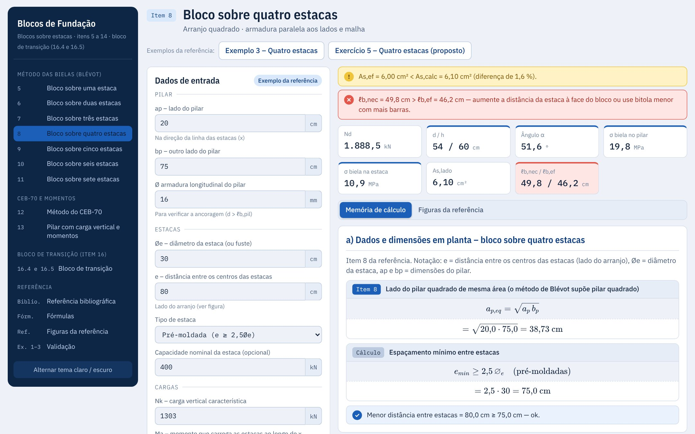
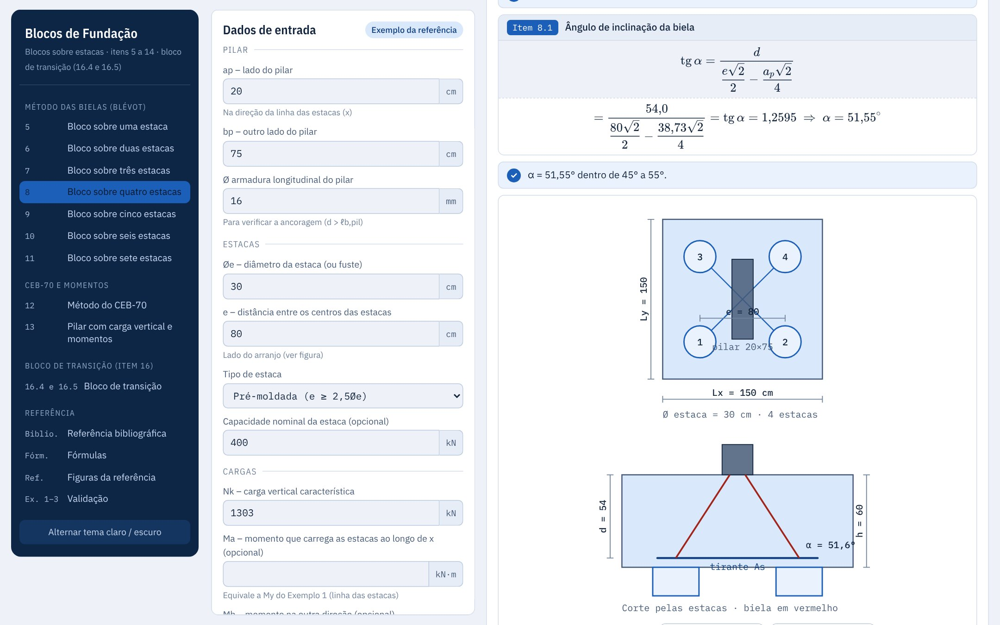
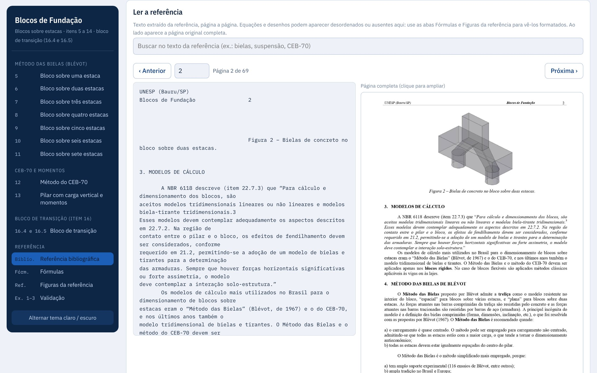
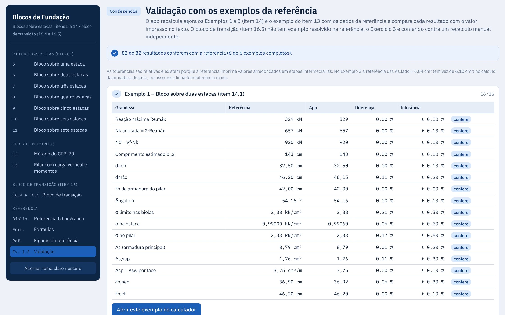
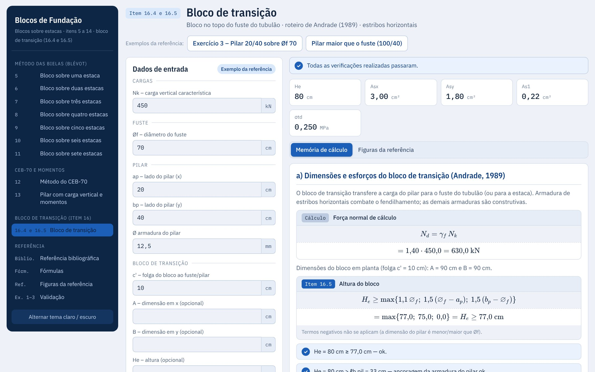

# Blocos de coroamento sobre estacas

Calculadora e referência de **blocos de fundação sobre estacas**, em um único arquivo `index.html`, baseada nas notas de aula *Blocos de Fundação* do Prof. Dr. Paulo Sérgio dos Santos Bastos (UNESP – Bauru/SP).

Cada calculadora gera uma memória de cálculo passo a passo, com as equações do texto, esboço, exemplos da referência e verificações.



## Como usar

Abra o `index.html` no navegador. Não precisa instalar nada nem subir servidor.

As equações usam KaTeX e as fontes vêm do Google Fonts, carregados da internet: sem conexão o cálculo funciona, mas as fórmulas aparecem como texto TeX.

Para publicar como site, ative o GitHub Pages em *Settings → Pages* (branch `main`, pasta `/ (root)`). Os caminhos de `figs/` são relativos e funcionam sem ajuste.

## O que o app tem

| Item do texto | Página do app |
|---|---|
| 5 | Bloco sobre uma estaca |
| 6 | Bloco sobre duas estacas (Exemplo 1) |
| 7 | Bloco sobre três estacas (Exemplo 2) |
| 8 | Bloco sobre quatro estacas (Exemplo 3) |
| 9 | Bloco sobre cinco estacas (quadrado com estaca central ou pentágono) |
| 10 | Bloco sobre seis estacas |
| 11 | Bloco sobre sete estacas |
| 12 | Método do CEB-70 |
| 13 | Pilar com carga vertical e momentos |
| 16.4 e 16.5 | Bloco de transição (roteiro de Andrade, 1989) |

Além das calculadoras:

- **Referência bibliográfica:** como citar, sumário com atalho "Calcular", busca no texto e leitor página a página, com o texto e a imagem da página completa (clique para ampliar).
- **Fórmulas:** todas as equações usadas, com a numeração do texto.
- **Figuras da referência:** as páginas com desenhos, agrupadas por assunto.
- **Validação:** o app recalcula os Exemplos 1 a 3, o exemplo do item 13 e o Exercício 3 do bloco de transição e compara com o texto (82 resultados). O bloco de transição não tem exemplo resolvido na referência, então esse caso é conferido contra um recálculo manual.

## Telas do app

**Memória de cálculo com as equações do texto e o esboço do bloco e das bielas.**



**Referência bibliográfica: texto extraído ao lado da página completa do PDF.**



**Validação: o app recalcula os exemplos da referência e confere cada resultado.**



**Bloco de transição (itens 16.4 e 16.5).**



## Estrutura do repositório

```
index.html        app completo: HTML, CSS, JavaScript e dados
figs/pNNN.jpg     páginas da referência; NNN = página do PDF (página do texto = NNN − 4)
tests/smoke.py    teste de fumaça (menu, validação e imagens do leitor)
tools/prints.py   gera os prints de docs/prints/ usados neste README
docs/prints/      prints do app (JPG)
CHANGELOG.md      histórico das mudanças
CLAUDE.md         notas de trabalho para quem for mexer no código
```

`figs/` tem as páginas 0 (capa e sumário, arquivos 001 a 004), 1 a 54 e 60 a 69. As páginas 55 a 59 são do item de tubulão e ficam no repositório [tubulao](https://github.com/victortlacerda/tubulao).

## Repositório relacionado

[victortlacerda/tubulao](https://github.com/victortlacerda/tubulao): fuste e base alargada do tubulão a céu aberto (itens 16.1 a 16.3 do mesmo texto). O bloco de transição (16.4 e 16.5) fica aqui.

## Como atualizar

1. Edite o `index.html` (ele é o app inteiro: ver `CLAUDE.md` para a organização interna).
2. Rode `python3 tests/smoke.py` (precisa de `pip install playwright` e `playwright install chromium`). A página Validação tem de continuar toda conferida.
3. Se a tela mudou, refaça os prints: `python3 tools/prints.py` (as instruções de instalação estão no topo do script).
4. Anote a mudança no `CHANGELOG.md`.
5. Faça o commit e envie: `git add -A && git commit -m "..." && git push`.

## Fonte e créditos

Texto-base:

> BASTOS, P. S. S. *Blocos de Fundação*. Notas de aula da disciplina 2133 – Estruturas de Concreto III. Bauru/SP: Departamento de Engenharia Civil e Ambiental, Universidade Estadual Paulista (UNESP), out. 2023.

Página do autor: <https://wwwp.feb.unesp.br/pbastos>. O texto segue a NBR 6118/2023 e a NBR 6122/2021.

Os direitos do texto e das figuras pertencem ao autor e à UNESP. As imagens de `figs/` são páginas dessas notas de aula, reproduzidas para consulta junto às fórmulas.

O app é uma ferramenta de apoio ao estudo e ao pré-dimensionamento: o projeto final deve ser conferido por engenheiro responsável.
